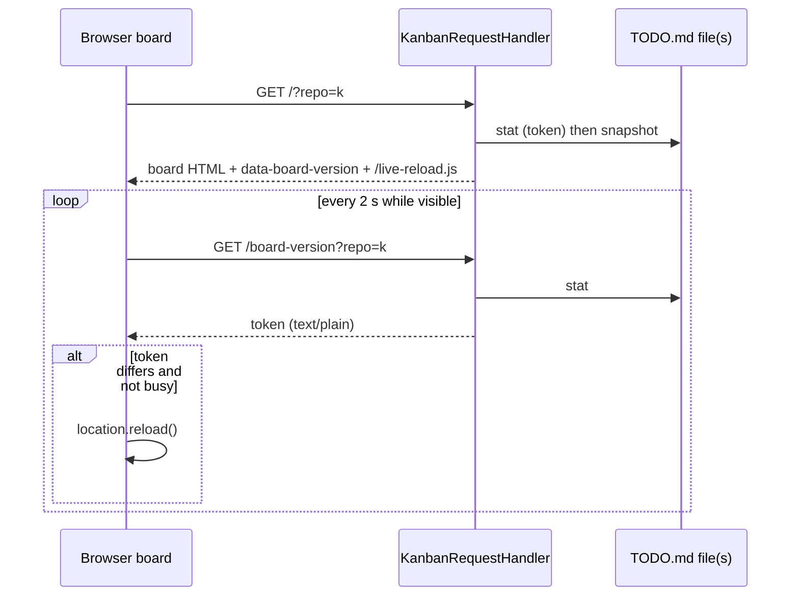

# T022 Live-Reload Kanban Board

> **For agentic workers:** REQUIRED SUB-SKILL: Use superpowers:subagent-driven-development (recommended) or superpowers:executing-plans to implement this plan task-by-task. Steps use checkbox (`- [ ]`) syntax for tracking.

**Goal:** An open Kanban Board shows external `TODO.md` edits (CLI or editor) within about 2 seconds without a manual refresh, for one repository and for All. Auto-refresh never discards an open modal or a half-filled form.

**Architecture:** Keep the stdlib loopback server (ADR 0007). Add `GET /board-version?repo=<key>`, which returns an opaque token built from `stat()` of the selected `TODO.md` file(s). The board embeds the same token, computed before its snapshot read. A same-origin `GET /live-reload.js` polls the endpoint and calls `location.reload()` when the token differs and the user is not busy. See [ADR 0012](../../docs/adr/0012-poll-a-board-version-token-for-live-reload.md).

**Tech Stack:** `KanbanWebApp` / `KanbanRequestHandler`, `hashlib`, `os.stat`, vanilla browser JS (`fetch`, `visibilitychange`).



**Locked decisions (grilled 2026-10-23):**

- Token = SHA-256 over `(path, st_mtime_ns, st_size)` per selected `TODO.md`. A missing or unreadable file contributes a `missing` sentinel instead of failing. Watch `TODO.md` only; the archive never renders and only changes alongside `TODO.md`.
- The baseline is embedded in the page as `data-board-version`, computed **before** the snapshot read. The worst case is one extra reload, never a missed change.
- Busy = `.modal.show` OR `.actions details[open]` (the card Cancel-reason form) OR focus on `input`/`textarea`/`select`. A busy tick is skipped, and the still-different token reloads on the next idle tick. The "+N more" overflow `<details>` is not busy; it collapses on reload.
- Poll every 2 s. Skip while `document.hidden`. Poll immediately on `visibilitychange`. Swallow fetch errors; no backoff.
- `GET /board-version` returns `text/plain` with an opaque token. It uses the same Host check and `resolve_selection`, so an invalid repo returns 404.
- JS is a module constant `LIVE_RELOAD_SCRIPT` in `web.py`, served at `GET /live-reload.js` as `text/javascript`. CSP: `script-src 'self' https://cdn.jsdelivr.net` and a new `connect-src 'self'`. No inline script, no hash.
- Only the 200 board page loads the script. Error pages don't: they share `render_error` with POST results, and a reload would resubmit.
- Custom first-party JS is acceptable whenever it is the simplest fit (user-confirmed; recorded in ADR 0012).
- Verification: pytest for server behavior, plus one manual Chrome pass for the JS. No Playwright.
- No `CONTEXT.md` change; no new domain term.

## Files

- Modify: `src/bot_todo/web.py`
  - `import hashlib`; import `TODO_FILENAME` from `bot_todo.repository`.
  - `SECURITY_HEADERS` CSP: `script-src 'self' https://cdn.jsdelivr.net; connect-src 'self';`.
  - New module constant `LIVE_RELOAD_SCRIPT` with a `#:` comment.
  - New `KanbanWebApp.board_version(selection) -> str`.
  - `render_board`: compute the version first. Put `data-board-version` and `data-version-url` on `.board-columns`. Append `<script src="/live-reload.js"></script>` to the content.
  - `do_GET`: route `/board-version` and `/live-reload.js`.
  - Generalize `_send_html` into `_send_body(status, body, content_type)`; keep `_send_html` as the thin caller.
- Modify: `tests/test_web.py`: new tests below, and update the existing `script-src https://cdn.jsdelivr.net` assertion (~line 830).
- Modify: `.scratch/kanban-web-frontend/spec.md`: remove "polling" from Exclusions; add a Live reload paragraph; update the CSP sentence in the security paragraph.
- Modify: `README.md`: one sentence under "Local Kanban Board": the board refreshes itself within ~2 s of external `TODO.md` changes, except while a dialog or form is in use.
- Create: `docs/adr/0012-poll-a-board-version-token-for-live-reload.md` (done).

## Sketches

```python
def board_version(self, selection: BoardSelection) -> str:
    if selection.store is not None:
        paths = [selection.store.todo_path]
    else:
        paths = [entry.path / TODO_FILENAME for entry in self.collection]
    digest = hashlib.sha256()
    for path in paths:
        try:
            stat = path.stat()
            part = f"{stat.st_mtime_ns}:{stat.st_size}"
        except OSError:
            part = "missing"
        digest.update(f"{path}\0{part}\n".encode())
    return digest.hexdigest()
```

```javascript
(() => {
  const board = document.querySelector("[data-board-version]");
  if (!board) return;
  const busy = () =>
    document.querySelector(".modal.show, .actions details[open]") !== null ||
    (document.activeElement?.matches("input, textarea, select") ?? false);
  async function poll() {
    if (document.hidden) return;
    try {
      const response = await fetch(board.dataset.versionUrl, { cache: "no-store" });
      if (!response.ok) return;
      if ((await response.text()) !== board.dataset.boardVersion && !busy()) {
        location.reload();
      }
    } catch {
      // Server stopped or restarting; try again next tick.
    }
  }
  setInterval(poll, 2000);
  document.addEventListener("visibilitychange", poll);
})();
```

`data-version-url` = `/board-version?{urlencode({'repo': selection.key})}`, HTML-escaped.

## Tasks

### Task 1: Version endpoint and token (TDD)

- [ ] Write failing tests in `KanbanWebTests`:
  - `GET /board-version` returns 200 `text/plain`, and two calls with no change return equal tokens.
  - The token changes after a `store.transaction()` add.
  - The token changes after a raw write that keeps the size but bumps mtime (`os.utime` with `ns=`), and after a same-mtime size change (`os.utime` back to the old `ns`).
  - `GET /board-version?repo=nope` → 404; wrong `Host` → 403.
- [ ] Write failing tests in `CollectionKanbanWebTests`:
  - The All token changes when any single entry's `TODO.md` changes.
  - An entry whose path doesn't exist still yields 200 and a stable token.
- [ ] Implement `board_version`, `_send_body`, and the `/board-version` route.
- [ ] `make pytest tests/test_web.py` passes.

### Task 2: Board embedding, script route, CSP (TDD)

- [ ] Failing tests:
  - The board's `data-board-version` equals the `GET /board-version` body for the same selection (single repo and All).
  - `data-version-url` carries the selection's `repo`.
  - The board includes `<script src="/live-reload.js">`.
  - `GET /live-reload.js` → 200, `text/javascript`, with security headers; the body contains `location.reload` and `data-board-version`/`boardVersion`.
  - The CSP contains `script-src 'self' https://cdn.jsdelivr.net` and `connect-src 'self'`.
  - Error pages (a POST 409 conflict, and an All partial failure 500) do **not** include `/live-reload.js`.
- [ ] Update the existing CSP assertion near `tests/test_web.py:830`.
- [ ] Implement `LIVE_RELOAD_SCRIPT`, the route, the `render_board` changes, and the CSP change.
- [ ] `make pytest` (full suite) passes.

### Task 3: Docs

- [ ] Update `spec.md` (Exclusions, Live reload paragraph, CSP sentence) and `README.md` (one sentence).

### Task 4: Quality gate

- [ ] `ruff check src/bot_todo/web.py tests/test_web.py`
- [ ] `mypy src/bot_todo/web.py`
- [ ] `make napoleon-gate` (`#:` on `LIVE_RELOAD_SCRIPT`; Napoleon docstrings on `board_version` and `_send_body`, including `Side Effects:` for file stats and socket writes).
- [ ] `make pytest`

### Task 5: Manual browser verification (Chrome)

Launch with `bot-todo web --no-open --port 0`, open the printed URL, then:

- [ ] `bot-todo add …` in a terminal: the card appears within ~2 s with no manual refresh.
- [ ] Open an edit modal and type in it, then mutate via the CLI: no reload, and the text is kept. Close the modal: reload within ~2 s.
- [ ] Expand a card's Cancel `<details>` and type a reason, then mutate via the CLI: no reload.
- [ ] Hand-edit `TODO.md` in an editor: the board updates.
- [ ] Repeat the CLI mutation on `?repo=all`: the All board updates.
- [ ] DevTools console shows no CSP violations.
- [ ] Move T022 to Review with `bot-todo --json review T022`.
